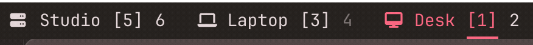
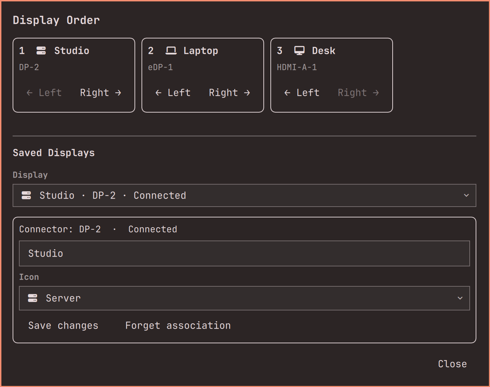

# Omarchy Display Workspaces Lite

**A read-only per-display workspace widget for the Omarchy menubar.**

**Plugin ID:** `display.workspaces.lite` · **Version:** 1.2.1

> **Caution — AI-generated by GPT Astra.** This plugin's custom implementation and documentation were developed with AI under human direction, building on Omarchy code. Treat it as experimental, review the code, and use it at your own risk.

## Preview

The pointer moves between displays and each display's label lights up; square brackets mark the workspace visible on that display, and empty inactive workspaces stay dimmed.



## What it does

- Groups workspaces under the display they are on, or the display a rule assigns them to.
- Shows workspaces HyprMonCfg declares even before Hyprland creates them.
- Tracks the visible workspace on each display and the keyboard-focused workspace separately, and keeps any workspace that still holds windows emphasized; only empty inactive ones dim.
- Highlights the display holding the pointer.
- Right-click the display label to name displays, pick icons, and order display groups. Connected displays appear as a menubar-order strip with move controls; a remembered-display picker edits connected or disconnected displays and forgets obsolete entries after confirmation.

Names, icons, and order are saved through Omarchy's native shell settings API against each display's connector plus its make/model/serial identity when available. They stay while a display is unplugged, are independent of HyprMonCfg profiles, and never touch Hyprland.



## Pair it with HyprMonCfg

This plugin only *reads* display and workspace state. For display management — saved layouts per setup, automatic switching on hotplug, lid open/close and resume, per-display brightness, scale, rotation and colour — use [**hyprmoncfg**](https://hyprmoncfg.dev/omarchy/), the multi-monitor manager this plugin is built to complement:

```bash
omarchy plugin add https://github.com/crmne/omarchy-hyprmoncfg.git --enable
```

That installs the panel shown in the Omarchy menubar; the first time, its **Install hyprmoncfg** button installs the stable AUR package, enables and starts `hyprmoncfgd.service`, and opens the layout editor. hyprmoncfg matches monitors by make, model and serial rather than the port they are plugged into, so a moved cable keeps the layout — and it is what writes the workspace rules this plugin reads to show a workspace before Hyprland creates it.

- [hyprmoncfg for Omarchy](https://hyprmoncfg.dev/omarchy/) — panel overview, install, and how it keeps ownership of your displays
- [Source and issue tracker](https://github.com/crmne/omarchy-hyprmoncfg) · [listing on Omarchy Plugins](https://omarchyplugins.com/plugin.html?id=crmne.hyprmoncfg)
- `hyprmoncfg doctor` prints the config load order, useful if a dotfile manager also edits `hyprland.lua`
- `omarchy plugin remove crmne.hyprmoncfg` removes the panel and leaves hyprmoncfg and your profiles installed

Neither plugin writes what the other owns: hyprmoncfg applies monitor configuration and workspace rules, Display Workspaces Lite only reads them.

## What it does not do

It never changes monitor position, mode, scale, transform, VRR, mirroring, or enabled state; never writes workspace rules or workspace-to-display assignments; never touches HyprMonCfg profiles or generated configuration; and never participates in suspend, resume, lid, dock, or hotplug policy. HyprMonCfg and Hyprland remain the only display and workspace configuration writers.

## Workspace discovery

Quickshell's live workspace model holds instantiated workspaces only, so a nonpersistent workspace such as 6 or 9 can be missing from the stock bar until first opened. This widget reads three interfaces and merges them:

```text
hyprctl -j monitors        hyprctl -j workspaces        hyprctl -j workspacerules
```

Existing live placement wins over a configured rule. A rule is used only when it enables one exact positive workspace number and names one enabled, non-mirrored display by exact connector or by unique exact `desc:` identity; broad, named, special, ambiguous, disabled, and invalid rules are ignored. Clicking a declared-but-uncreated workspace asks Hyprland to open it, and Hyprland plus the existing rule decide where it lands. `workspace_catalog.py` performs the reads; it degrades to live workspaces alone when a compositor has no `workspacerules`.

## Install

```bash
omarchy plugin add https://github.com/nephilus/omarchy-display-workspaces-lite.git --enable
```

To place it on the left:

```bash
omarchy plugin enable display.workspaces.lite --section left
```

Then disable the fuller variants so two bars do not compete:

```bash
omarchy plugin disable display.workspaces
omarchy plugin disable omarchy.workspaces
```

Plugin IDs and presentation settings are separate, so Lite does not migrate names, icons, or order from `display.workspaces`.

`omarchy plugin update` rescans plugins but Quickshell rebuilds them from its cached component, so an updated **code** file needs one more step:

```bash
omarchy restart shell
```

Without it the bar keeps running the previous version and looks like a failed update.

## Requirements

Omarchy's native Quickshell plugin system, Hyprland with `hyprctl`, and Python 3's standard library. HyprMonCfg is recommended but not required — ordinary exact Hyprland workspace rules work too. Nothing is installed: no daemon, systemd unit, dependency package, profile store, or background service, and no third-party code to patch.

## Security and resources

- **Reads** are limited to `hyprctl -j monitors`, `workspaces`, `workspacerules`, and `cursorpos`. **The only write** is focusing a workspace the user clicks; `dispatch` is never used for anything else. Both are enforced by `test_plugin_hygiene.py`.
- **No shell.** Helpers are spawned with an argv array, never `shell=True`, and workspace ids are validated as positive 32-bit integers before they reach `hyprctl`. Focus works on Lua-configured compositors (Omarchy's default, which evaluates dispatch requests as Lua) and on classic `.conf` compositors, by picking the matching syntax and falling back on a rejected attempt.
- **Nothing leaves the machine.** No network access, no telemetry, no logging of monitor make, model, or serial. Catalog output is validated before it reaches the bar, so corrupt output keeps the last good model.
- **Cost** is one short `hyprctl -j cursorpos` poll per 100 ms for pointer highlighting (about 3 ms) and one catalog read per display or workspace change burst (about 35 ms, debounced). Both were measured before choosing to keep them simple.

## Verification

```bash
omarchy plugin validate .
python3 -m unittest discover
```

## License

[MIT](LICENSE). Derived from [Omarchy](https://github.com/basecamp/omarchy), including its workspace widget; the upstream copyright notice is retained. This is a third-party plugin, not an official Omarchy release.

The pictures under `docs/` were taken from a real session with placeholder display names and cropped to the widget and its panel: they contain no monitor make, model, serial, path, or surrounding desktop content.
